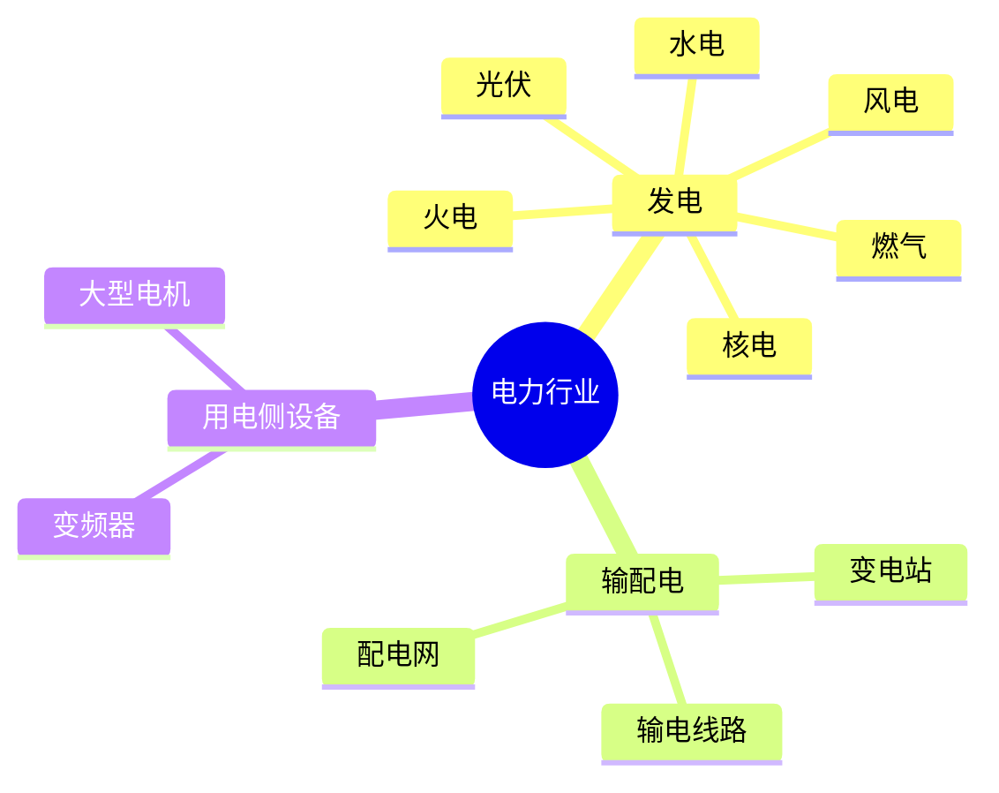

# 执行摘要  
本报告梳理了涵盖发电（火电、燃气、核电、水电、风电、光伏）、输配电（变电站、输电线路、配电网）及用电侧大型设备（大型电机、变频器等）的主要设备类型、代表厂商、关键部件及其故障模式等关键信息层次。首先明确电力行业子领域和典型设备范畴（如锅炉、汽轮机、发电机、变压器、GIS等）及国内外主要供应商【5†L1-L4】【47†L25-L28】。随后列出各设备的重要组成部件及功能描述，如发电机的定/转子绕组、轴承、冷却系统等；变压器的铁芯、绕组、油箱、散热系统等。针对每个部件，归纳常见故障类型及成因（按机械、电气、热、化学、环境、操作等分类），如发电机轴承因润滑不足造成过热、转子失衡引发振动【43†L62-L70】【46†L61-L65】。最后说明每种故障所需的信息维度：监测手段（传感器类型、采样等）、诊断方法（阈值、特征、故障树、机器学习示例）、检修方案（临时措施、备件更换）、故障特征参数（振动频域、油样、局放等）、优先级与风险、典型案例、预防维护建议、所需工具与安全注意、诊断置信度、不确定性说明，以及相关标准/规范、备件寿命及成本停机时间估算等。报告采用层级大纲形式组织内容，并附有示例表格和建议检索来源列表，供构建离线知识库时参考。

## 一、电力行业范围  
- 发电端：包括燃煤火电、燃气（燃气轮机+余热锅炉）、核电（压水堆等反应堆＋汽轮机＋发电机）、水电（蓄能、常规水电站）、风电（陆上/海上风力机组）、光伏（组件＋逆变器）等子行业。  
- 输配电端：涵盖变电站（GIS、开关站）、输电线路（高/超高压架空线、变电铁塔、绝缘子）、配电网（配电变压器、配电开关、智能化杆塔等）。  
- 用电侧大型设备：如大型电机（工业电机、轴流风机电机等）、大功率变频器/软起动设备、大型UPS系统等。

## 二、设备类别与代表厂商（示例）  
各主要领域代表设备及主要供应商如下（详见表1）：  
- **火电设备**：典型设备包括电站锅炉、汽轮机、汽轮发电机、除灰/脱硫/脱硝系统等；国内主机厂商为东方电气、上海电气、哈尔滨电气等【5†L1-L4】【5†L7-L10】。  
- **燃气发电设备**：典型为燃气轮机及余热锅炉（联合循环机组）；主要机厂包括上海电气燃气轮机（与安萨尔多合资）等，国外有GE、西门子、三菱等【12†L88-L92】【12†L101-L105】。  
- **核电设备**：典型为核岛主设备（反应堆压力容器、蒸汽发生器、稳压器、主泵）、常规岛汽轮机及发电机；国内主机厂有东方电气、上海电气、哈尔滨电气【17†L26-L33】【9†L52-L60】，中国一重、二重等提供重型锻件。  
- **水电设备**：典型为水轮发电机组（冲击式、混流式等）、水泵、闸门等；国内厂商有东方电机、哈电集团，国际厂商如Voith/Andritz在中国亦有业务。  
- **风电设备**：典型为风力发电机组（叶片、齿轮箱、发电机、塔架等）；国内厂商如金风科技、明阳智能、远景能源、运达股份、三一重能、东方电气风电等【27†L116-L120】。  
- **光伏设备**：典型为光伏组件（硅片、组件）、逆变器、跟踪支架；代表厂商包括隆基绿能、晶科能源、天合光能、晶澳太阳能、正泰新能源（组件），阳光电源、固德威（逆变器）【29†L60-L69】【29†L72-L80】。  
- **输配电设备**：典型为变压器（电力变压器、配电变压器）、GIS/开关装置、高压断路器、互感器、避雷器、导线/电缆、输电铁塔/输电线路；代表厂商有特变电工、保变电气、许继电气、中国西电、上海电气、海南金盘等【47†L25-L28】。  
- **用电侧大设备**：典型为大型工业电机（如发电厂电动机、大型压缩机电机等）、大功率变频器等；国内大型电机生产商如上海电机厂、哈尔滨电机厂等，变频器厂家如英威腾、施耐德、ABB（中国）等。  

表1：**电力行业主要设备类别与代表厂商**  

| 设备类别      | 典型设备                             | 代表厂商（国内/国际）                 | 主要资料来源                                |
|---------------|-----------------------------------|--------------------------------------|-----------------------------------------|
| 火电（煤电）   | 电站锅炉、汽轮机、汽轮发电机、除尘脱硫等   | 东方电气、上海电气、哈尔滨电气【5†L1-L4】【5†L7-L10】 | 国信证券报告【5†L1-L9】               |
| 燃气发电      | 燃气轮机、余热锅炉、燃气发电机组         | 上海电气燃机（安萨尔多）、杭汽轮、中科国晟； GE、西门子、三菱（国外）【12†L88-L92】 | 界面新闻【12†L88-L92】              |
| 核电          | 核岛：反应堆压力容器、蒸发器、稳压器、主泵；常规岛：汽轮机、发电机 | 东方电气、上海电气、哈电【17†L26-L33】【9†L52-L60】（核电装备）；一重、二重（锻件） | 国家能源局核电装备路线图【17†L26-L33】 |
| 水电          | 水轮机组（冲击式、混流式）、水泵、闸门等   | 东方电机、哈电集团、国电南瑞（辅件）等；Voith/Andritz等（国际） | 东方电气/哈电官网                        |
| 风电          | 风力发电机组（叶片、齿轮箱、发电机、塔架） | 金风科技、明阳智能、远景能源、运达股份、三一重能、东方电气风电【27†L116-L120】 | 中国风电头条【27†L116-L120】         |
| 光伏          | 组件（硅片、组件）、逆变器、跟踪支架     | 隆基、晶科、天合、晶澳、正泰；阳光电源、固德威、华为等 | 新浪财经【29†L60-L69】【29†L72-L80】   |
| 输配电（变配电） | 变压器（电力/配电）、GIS、断路器、导线、电缆、铁塔、开关柜 | 特变电工、保变电气、许继电气、中国西电、上海电气、海南金盘【47†L25-L28】 | 头豹报告【47†L25-L28】              |
| 大型用电设备  | 大型工业电机（发电厂、水泵电机等）、大功率变频器 | 上海东方电机、哈尔滨电机厂、ABB（中国）、西门子（中国）、英威腾、施耐德等 | 行业资料                                  |

## 三、关键部件及功能（示例）  
以下以典型设备为例，列出其主要部件及功能：  
- **电站锅炉**：燃烧器、炉膛（燃烧室）、省煤器、再热器、空气预热器、除灰器等，用于燃料燃烧和热能传递。  
- **汽轮机**：高/低压转子及叶片、固定导叶、汽轮机轴、轴承、汽门（调速阀）、密封箱、冷却系统等，用于将蒸汽热能转化为机械旋转能【16†L7-L14】。  
- **发电机**：定子（绕组、铁芯）、转子（极/铁芯）、端盖、轴承、冷却风扇及冷却回路、励磁系统（励磁绕组或励磁机）、碳刷（同步发电机）等，用于电磁发电【43†L74-L81】。  
- **变压器**：铁芯、绕组、高/低压套管、油箱、散热器（风冷/油冷）、保护继电器、接地装置等，用于电压变换和电能传输。  
- **GIS/断路器**：密封气体（SF₆）金属壳体、断路器触头、隔离开关、互感器、控制柜等，用于高压电流切换与隔离。  
- **输电线路**：导线（架空线/地线）、绝缘子、地线塔/铁塔、避雷器等，用于长距离电能传输。  
- **配电网设备**：配电变压器、配电柜、开关站（环网柜）、断路器、刀闸、智能电表等，用于中低压配电。  
- **风力发电机组**：叶片、主轴、变桨系统、齿轮箱、发电机、偏航系统、塔架、机舱罩（动力头）等，用于风能转换和发电。  
- **光伏组件**：光伏电池片、玻璃封装、背板等；**逆变器**：整流/逆变单元、电抗器、控制器、散热系统，用于直流/交流转换。【29†L60-L69】  
- **大型电机**：定、转子绕组、转轴、轴承、通风冷却系统等，用于驱动工业机械。  
- **变频器**：整流单元、直流链路电容、逆变单元、控制板、滤波器、冷却风扇等，用于电机转速与扭矩的可调控制。  

## 四、部件故障模式与成因（示例）  
对各关键部件，可按故障类型分类（机械、电气、热、化学、环境、操作等），示例如下：  
- **轴承**（机械/热故障）：常见失效模式包括润滑油膜破裂导致接触摩擦磨损（机械磨损）、过载或不对中引起过热【43†L62-L70】【46†L61-L65】。成因可能为油质劣化或缺失、装配误差振动过大、腐蚀污染（化学/环境）等。  
- **转子**（机械故障）：失衡（叶片污垢、零件脱落）、裂纹（机械疲劳）、扭转振动，可能因加工偏差、运行过载或疲劳损伤而产生【46†L61-L65】。  
- **联轴器**（机械故障）：错位、破裂，多由于装配不当或振动导致【43†L62-L70】。  
- **定/转子绕组**（电气故障）：绕组绝缘老化、匝间短路、接地故障等，导致绕组电阻变化或温升异常【43†L74-L81】【46†L81-L84】。成因包括过载运行、绝缘材料老化、涂层脱落、水分侵入等。  
- **冷却系统**（热/化学故障）：如散热器堵塞、风扇故障、冷却介质（如氢气）纯度下降【46†L81-L84】。成因为冷却风路受阻、控制失灵、介质泄漏或污染等。  
- **润滑系统**（化学故障）：油质劣化、水分超标、滤网堵塞【46†L69-L75】；油泵故障会导致油压下降或油温升高（热问题），主要由于油污、水分、长期使用致使油循环不畅。  
- **密封件/绝缘子**（环境故障）：老化、裂纹、污染，导致泄漏、闪络等故障，原因可能为紫外照射、酸雨腐蚀、表面尘污积累等。  
- **碳刷/换向器**（电气机械故障）：磨损不均、接触不良，会产生电火花、烧蚀；成因通常为负载波动大或维护不足【43†L74-L81】。  

## 五、故障信息维度与诊断支持（示例）  
针对上述故障，需要综合多维信息支持诊断：  
- **监测手段**：振动传感器（轴承振动、叶片振动）、温度传感器（轴承、绕组）、油质传感器（水分、颗粒度）、局部放电探头、气体分析仪（氢气含量）、红外成像、声发射等。采样频率视信号特性定（如高频振动采样可达kHz级）。安装位置需覆盖关键轴承端、敏感区域、油路等。  
- **诊断方法**：可结合规则或模型：阈值预警（如轴承振动速度超过ISO限值）、故障树分析、贝叶斯网络；信号特征工程（时域峰值、均方根、频谱主频、包络谱）结合专家经验；典型方法包括谱分析、时频分析、神经网络/支持向量机等机器学习算法，或深度学习在局放图谱/音频信号上的应用。  
- **检修/处置**：分为临时处置（清理、再润滑、调节对中等）和根本修复（更换轴承、叶片、修复绕组、更换传感器、升级防腐材料等）；流程需根据设备级别和危险等级制定。应明确所需备件（轴承套件、密封圈、导叶、绝缘材料等）及其预计寿命，对备件保有量进行估计。  
- **故障特征参数**：如振动时域指标（有效值、峰值）、频域指标（某一阶频率幅值）、包络谱峰值；温度曲线；油样分析（颗粒计数、水分%）；绕组绝缘电阻、局放量值；声学特征；电流电压谐波分量等。  
- **优先级/风险等级**：基于故障对安全、可靠性影响评估，轴承、主轴类故障通常优先级最高（可能导致机组停机或事故），电气短路则居高危；可采用A/B/C等级或临界/警告等标示。  
- **典型案例与故障工况**：编撰真实运行案例，如“某火电厂300MW机组因转子不平衡引发振动升高停机”，“某风机因叶片裂纹脱落导致偏航系统故障”说明故障征兆与处置。  
- **预防性维护**：针对常见弱点制定维护方案，如定期轴承加油、运行中监控振动趋势；对易损件（滤网、密封、刷板）制定检修周期；加强环境清洁防护（防尘、防潮）；实施可靠性中心维护（RCM）和状态监测计划。  
- **所需工具与安全事项**：列明维修所用工具（红外测温枪、泄漏检测仪、高压绝缘棒、起重工具等）和安全操作规范（停电隔离、接地、氢气防爆、个人防护等）要求，确保维护人员安全。  
- **诊断置信度与不确定性**：说明监测诊断信号的准确度、噪声干扰程度和建模不确定性，必要时结合多传感器、多方法综合判断，提高可靠性。  
- **相关标准与规范**：参考国家/行业标准如《GB/T 10069-2004 发电机通用规范》《GB/T 10228-2015 干式变压器损耗标准》《DL/T 923-2010 汽轮机运行维护规程》等，以及IEC/IEEE标准的中国实施版。  
- **备件寿命与成本估算**：基于厂商资料和经验数据，估计关键备件（轴承、叶片、绕组绝缘件等）寿命，计算更换成本及相应停机时间。  

表2为某典型汽轮发电机组示例的部件—故障矩阵：  

表2：**汽轮发电机组部件—故障矩阵（示例）**  

| 部件       | 常见故障                          | 主要监测手段              | 典型特征参数             | 优先级  |
|------------|----------------------------------|-------------------------|----------------------|-------|
| 转子轴系    | 不平衡（轴承积污）、对中偏差         | 振动传感器（1×转速振幅）   | 振动幅值（1×基频）、轴向/径向不平衡频率成分 | 高    |
| 轴承       | 磨损、油膜振荡、局部打滑            | 振动、温度传感器         | 振动有效值、轴承温度       | 高    |
| 润滑油系统   | 油质劣化（水分、杂质）、滤网堵塞     | 油质传感器、压力传感器     | 滤网压差（MPa）、含水率（%）  | 中    |
| 定子绕组绝缘  | 绝缘老化（漏电）、局部放电          | 绝缘电阻测试、局部放电监测  | 绝缘电阻变化率、PD电荷(pC) | 中    |
| 冷却系统（氢冷） | 氢气纯度下降、散热不足           | 氢气纯度分析仪、温度传感器  | H₂含量(%)、绕组/轴承温度   | 中    |

- **说明**：此表仅为示例，实际设备可能包含更多部件（如调速阀、冷却水泵等）。相应故障诊断需补充传感器类型、采样参数及算法模型等具体内容。

## 六、建议优先检索来源  
- **国家能源局/行业机构**：国家能源局、中国核能行业协会等官网发布的核电、水电、可再生能源装备与标准政策；中国可再生能源学会（如风能专业委员会）的统计数据与报告【27†L116-L120】。  
- **行业标准与规范**：电力行业标准（如DL/T系列）、国家标准（如GB/T 10069《发电机通用规范》、GB/T 10228《变压器损耗标准》、GB/T 33513《风力发电机组状态监测》、DL/T 923《汽轮机运行维护规程》等）。  
- **主机厂技术资料**：东方电气、上海电气、哈尔滨电气、特变电工、许继电气等企业的产品技术手册与服务指南，涵盖设备构造、维护规程及故障案例。  
- **行业研究报告**：机械工业电源装备中心等发布的统计年报与市场分析报告，以及券商、咨询机构的深度行业报告【5†L1-L4】【39†L359-L361】。  
- **学术文献与综述**：《电力系统自动化》、《继电保护与自动化装置》及机械、电力自动化领域的中文核心期刊文章，尤其是设备故障诊断与预测维护方面的综述和案例研究。  
- **检测与维护规范**：发电厂技术规程、运行维护手册（如电力设计、运行分册），包括设备厂商与电网企业编制的检修方案。  

以上资料可作为检索重点，以确保知识库内容的权威性和全面性。